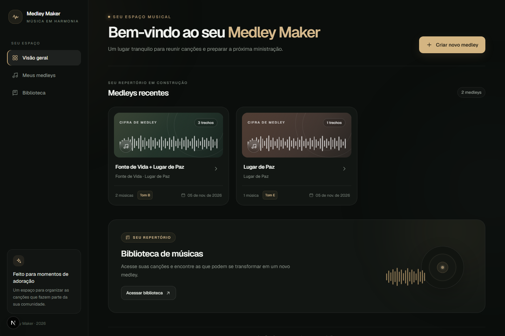
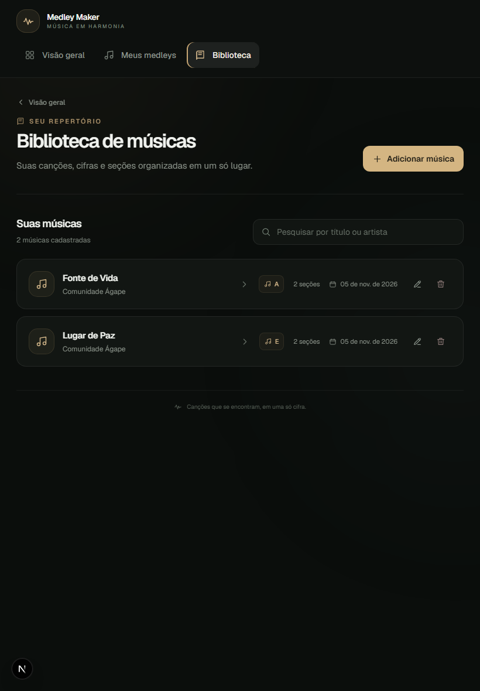
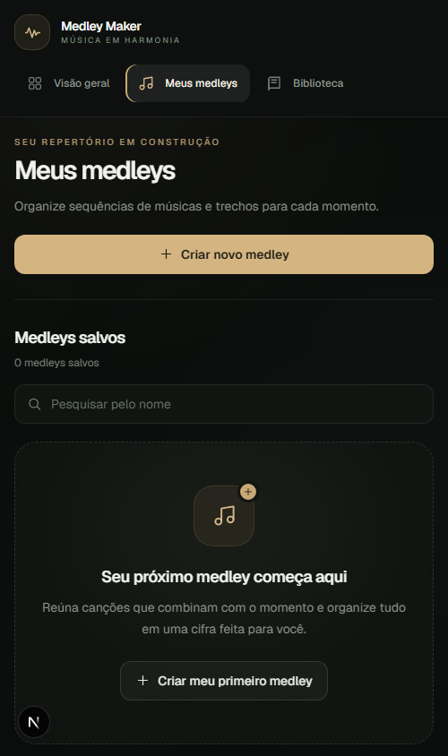

# Medley Maker

Medley Maker is a dark, musician-focused web app for organizing song charts and building medleys from selected sections of multiple songs. It is designed especially for worship musicians who need a clear, practical way to prepare a continuous set.

## Screenshots

### Desktop



### Tablet



### Mobile



## Features

- **Song library:** create, view, edit, delete, and search songs by title or artist.
- **ChordPro-style charts:** organize lyrics and chords into named sections such as verses, choruses, bridges, and endings.
- **Medley builder:** combine selected song sections, arrange their order, and keep independent snapshots of the selected content.
- **Chord transposition:** preview a song in another key or transpose a medley while preserving its original snapshots.
- **PDF export:** export a medley chart from its preview, formatted as one continuous song.
- **Local persistence:** songs and medleys are stored in the browser's `localStorage`; no account or external database is required.
- **Responsive dark interface:** designed for desktop, tablet, and mobile screens.

## Tech stack

- Next.js 16 with the App Router
- React 19
- TypeScript
- Tailwind CSS 4
- jsPDF for PDF generation
- Browser `localStorage` for persistence
- Node.js and npm for development

## Run locally

### Requirements

- Node.js 20 or later
- npm (included with Node.js)

### Install and start

```bash
git clone https://github.com/jeffersonsil813/medley-maker.git
cd medley-maker
npm install
npm run dev
```

Open [http://localhost:3000](http://localhost:3000) in your browser. The development server reloads the app when source files change.

To run the available checks and create a production build:

```bash
npm run lint
npm test
npm run build
```

## Data storage

The current version stores all song and medley data in the browser's `localStorage`. Data remains in the same browser profile on that device. Clearing browser storage removes this local data; it is not synchronized between devices.

## Development

The project was developed with support from ChatGPT Codex throughout the planning, implementation, debugging, and verification workflow.

## Live demo

**Deployment URL:** [https://medley-makerr.vercel.app/](https://medley-makerr.vercel.app/)

## License

This project is licensed under the [MIT License](LICENSE).
